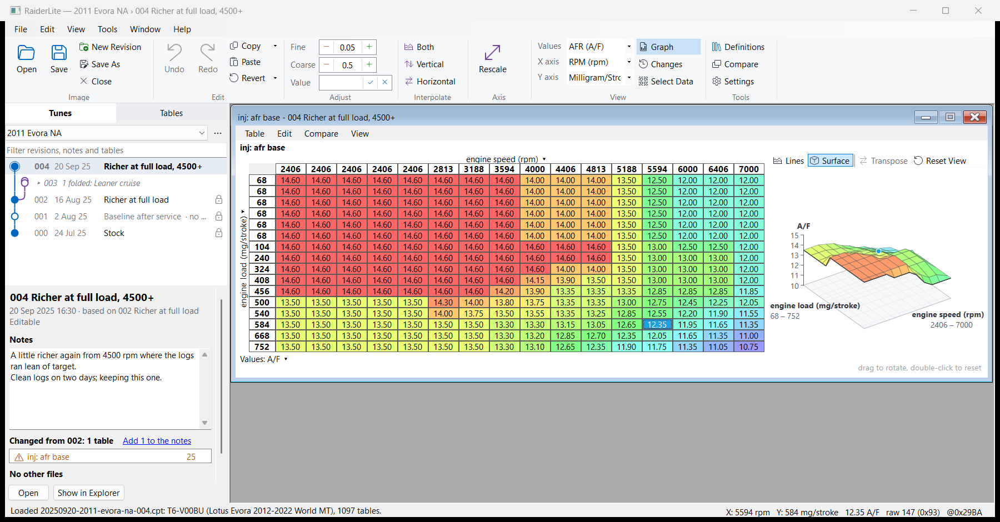

# RaiderLite

A lightweight Windows editor for ECU calibration tables. RaiderLite opens raw ROM images, shows
their tables using [RomRaider](https://github.com/RomRaider/RomRaider) XML definitions, and saves
your edits back to the image. It is a C#/.NET port of RomRaider's table editor: editing only, no
logger.



> **Warning:** changing an ECU calibration can damage an engine. Always keep an untouched copy of
> the original image, and check every change before flashing it. RaiderLite comes with
> **no warranty** (see [License](#license)).

## Features

- **RomRaider definitions:** the same XML format (`<roms>`, `<rom base=…>` inheritance,
  `<scalingbase>`, child roms), so existing definition files work unchanged. The most specific
  matching ROM ID is chosen automatically.
- **Images:** raw binary images (`.bin`, `.rom`) and Lotus `.cpt` calibrations; saving writes to a
  temporary file and replaces the original only once it is complete.
- **All table types:** scalars and arrays, curves (2D), maps (3D, including swapped, flipped and
  skipped layouts), switches and bit switches; all storage types (8/16/32-bit integers, float,
  MOVI20/MOVI20S) in either byte order, masks and the Bosch subtract layout.
- **Editing:** type a value, increment/decrement by fine or coarse steps, multiply, interpolate
  (along the axis values), copy and paste (RomRaider's formats and spreadsheet blocks), undo/redo
  and revert. Values snap to what the storage can actually hold, so what you see is what is saved.
- **Rescale Axis:** give one axis of a curve or map new breakpoints (stretch, even spacing or typed
  values) and the data is resampled so lookups stay the same; the table's range can be widened
  without changing how the engine runs today.
- **Scalings:** switch between a table's scalings (metric, imperial, raw...).
- **Compare:** show changes against the original values or the same table in another image, and
  list every table that differs between two images.
- **Checksums:** recalculated on save (STD, ALT, ALT2, BYTEXOR, COPY, Motronic single/double,
  E38 PCM, Subaru "Checksum Fix").
- **Graphs:** optional read-only line graphs and 3D surfaces of curves and maps, GPU-accelerated
  with Direct2D (off by default; turn on in Settings or press Ctrl+G in a table).
- **Tune history:** keep each car's calibrations as numbered revisions in a tune library folder,
  each with its image, notes and other files (logs, flash files). The Tunes panel shows them as a
  timeline with branches; each revision lists the tables changed from the one it was based on, and
  revisions can be searched, compared, rejected (with a reason) or hidden. Revisions that others
  are based on stay read-only, so the history can't be changed by accident. Start a car from its
  stock image (**New Car**) or from any image you already have (**Import Image as New Car**). It is
  all plain folders and a `car.json` index, readable without RaiderLite.
- **Colours:** table colours are configurable, with a colour-blind friendly preset.

Not included: data logging, dyno, live data and flashing. Use your usual tools to read and write
the ECU.

## Install

1. Install the [.NET 10 Desktop Runtime](https://dotnet.microsoft.com/download/dotnet/10.0) (x64)
   if you don't have it. RaiderLite prompts with a download link if it's missing.
2. Download `RaiderLite-<version>-x64.msi` from [Releases](https://github.com/donour/RaiderLite/releases)
   and run it. It installs to `Program Files\RaiderLite` and adds a Start menu shortcut.

To **upgrade**, run a newer installer: it replaces the installed version in one step (and puts the
old one back if anything fails). An older installer won't install over a newer version. Settings
are kept in `%APPDATA%\RaiderLite` and survive upgrades and uninstalling. RaiderLite never checks
for updates over the network.

### Verify the download

Each release lists the installer's SHA-256 checksum and includes it as a `.sha256` file. To check a
download in PowerShell:

```powershell
Get-FileHash .\RaiderLite-0.2.0-x64.msi -Algorithm SHA256
```

The hash shown must match the one on the release page.

## Getting started

1. **Edit > Definition Manager** (or **Definitions** on the ribbon): add your RomRaider definition
   files (`.xml`).
2. **Open** an image (or drop it on the window). RaiderLite picks the matching definition and lists
   its tables by category; type in the filter box to find one.
3. Click a table to open it, click it again to close it. Select cells and type a value, or use the
   ribbon's Adjust and Interpolate commands. **Help > Keyboard Shortcuts** lists the keys.
4. **Save** (Ctrl+S) or **Save As** writes the image, updating its checksums.
5. To keep a history of a car's tunes, use **File > Import Image as New Car** (or **New Car** with the
   stock image). The **Tunes** tab then lists its revisions: **New Revision** (Ctrl+Shift+N) copies
   one to edit, with a label and notes. The library folder is set in **Edit > Settings**.

## Building from source

Requires the [.NET 10 SDK](https://dotnet.microsoft.com/download/dotnet/10.0) on Windows.

```powershell
dotnet build                          # app, core library and tests
dotnet test                           # unit tests
dotnet run --project RaiderLite       # run the editor
dotnet build Installer -c Release     # Installer\bin\Release\RaiderLite-<version>-x64.msi
```

The installer is built with the [WiX Toolset](https://wixtoolset.org/) SDK, restored from NuGet; no
separate install is needed. To open the installer project in Visual Studio, install FireGiant's free
[HeatWave](https://www.firegiant.com/heatwave/) extension.

| Folder | Contents |
|---|---|
| `RaiderLite.Core` | definitions, expressions, table model, byte encoding, checksums (no UI) |
| `RaiderLite` | the WinForms editor |
| `RaiderLite.Tests` | xUnit tests (self-contained: inline definitions and synthetic images) |
| `Installer` | WiX MSI project |

### Releases

Pushing a version tag builds the installer on GitHub Actions and attaches it, with its checksum, to
a GitHub release:

```powershell
git tag -a v0.2.0 -m "RaiderLite 0.2.0"
git push origin v0.2.0
```

The installer's version comes from the tag (`v1.2.3` or `v1.2.3.4`). Windows compares only the
first three numbers when upgrading, so change one of those for every release.

## Code signing policy

Releases are built from this repository by GitHub Actions ([workflow](.github/workflows/installer.yml)).
They are **not code-signed yet**, so Windows SmartScreen may warn when you run the installer;
check the download against its published checksum (see [Verify the download](#verify-the-download)).

Team roles:

- Committers and reviewers: [Donour Sizemore](https://github.com/donour)
- Approvers: [Donour Sizemore](https://github.com/donour)

### Privacy

RaiderLite does not transfer any information to other networked systems unless specifically
requested by the user or the person installing or operating it. (The only network activity is
opening the web links in the About box in your browser, when you click them.)

## License

Copyright © 2026 Donour Sizemore. RaiderLite is free software under the
[GNU General Public License version 2](LICENSE).

RaiderLite is a port of the table editor in [RomRaider](https://www.romraider.com),
Copyright © 2006-2025 RomRaider.com, also licensed under the GPL. Thank you to the RomRaider
developers and community, whose work made this project possible.
